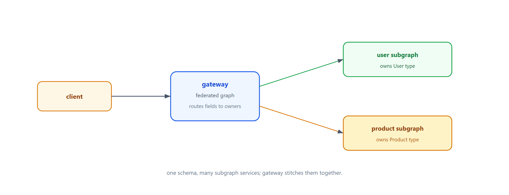
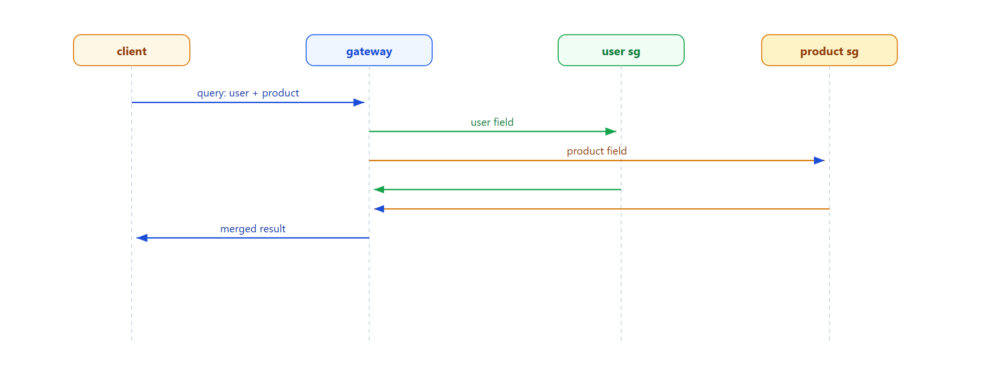

# Learn GraphQL Federation — One Graph, Many Subgraph Services

> **Learning / study repo. Self-contained demo, NOT production code.**
> Each subgraph service owns part of the schema. A gateway combines them into one federated
> graph and routes each query field to the service that owns it.

## The idea

```
  client ──► gateway ──► user subgraph   (owns User type)
                    └─► product subgraph (owns Product type)
```

- One query can touch multiple subgraphs.
- Each subgraph owns its types and data.
- Gateway stitches them into a single schema.



## Why this matters

- **Domain ownership** — teams own their subgraph independently.
- **One endpoint** — client gets a unified graph, not many REST calls.
- **Incremental adoption** — add subgraphs one by one.

## Run

```bash
python run_all.py
```

Pure Python standard library.

## Demo case

- One query asks for `user` + `product`; gateway routes each to the owning subgraph.

## Flow



## Sibling repos

- `learn_bff_gateway` — the aggregation layer for frontends.
- `learn_microservice_by_id` — services split by domain.
- `learn_sidecar_proxy` — cross-cutting per service.
